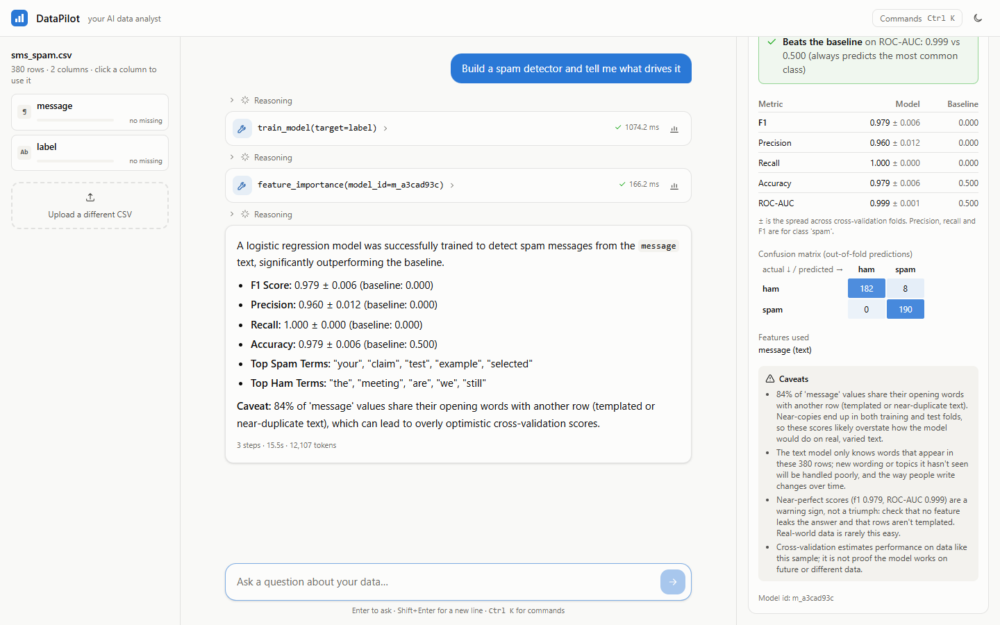
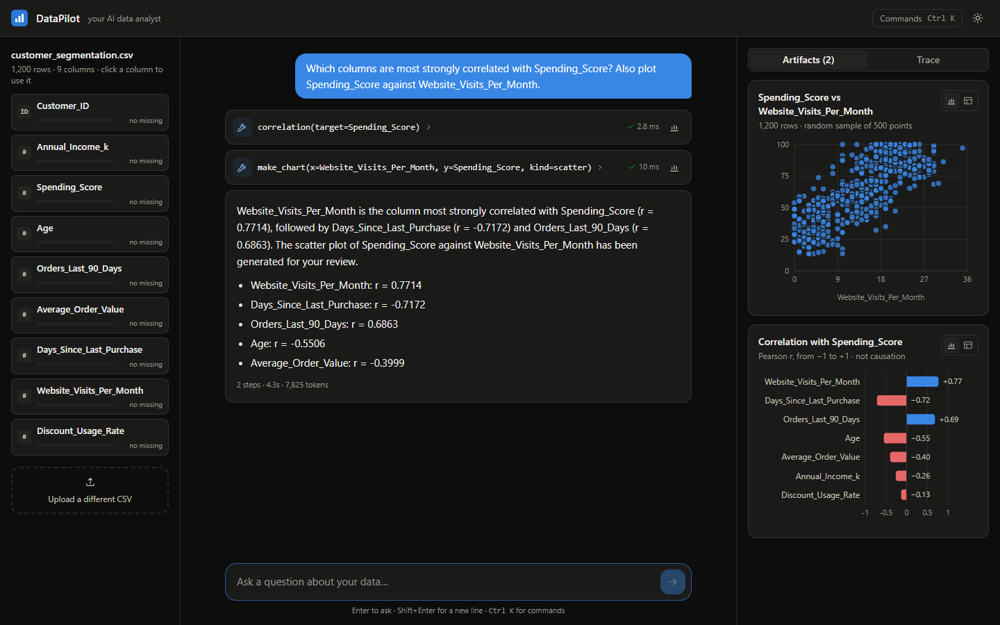
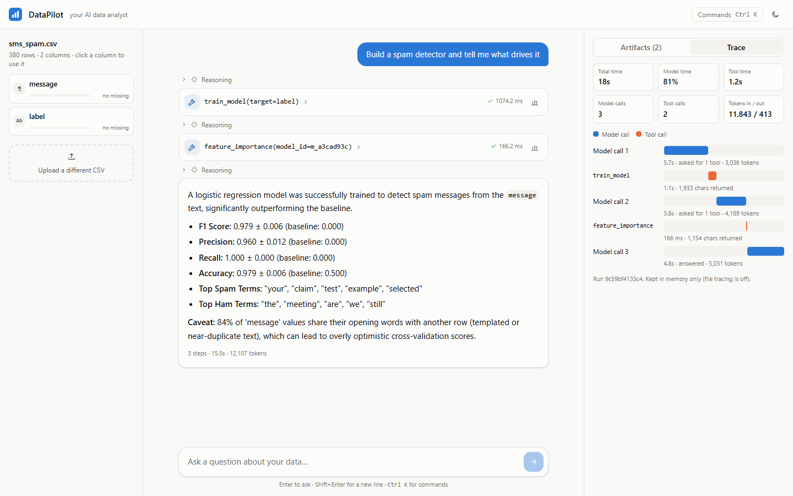
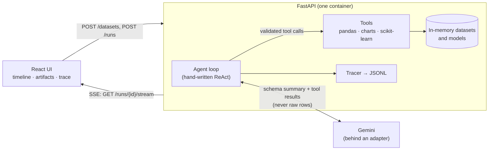

# DataPilot

**An AI data analyst you can watch think.** Upload a CSV, ask a question in plain English, and
an LLM agent answers it by calling real pandas and scikit-learn tools, step by step, live in
your browser. Every number in an answer comes from a tool result, never from the model's
imagination.

**Live demo: [datapilot-pjp6.onrender.com](https://datapilot-pjp6.onrender.com)**. Upload one of the
CSVs in [sample_data/](sample_data/) or your own. It runs on free tiers: the first visit after
a quiet spell takes about a minute to wake the server, and the shared Gemini quota allows only
a handful of questions a day, so it may reply "daily quota used up" until the next day.



*Asked "Build a spam detector and tell me what drives it", DataPilot trains a cross-validated
model, compares it with a baseline, explains which words drive it, and flags why the scores are
probably too good. Real Gemini output.*

## What it does

- **Answers questions about any CSV**: counts, averages, filters, correlations, charts.
- **Builds and explains ML models**: classification and regression with scikit-learn pipelines,
  k-fold cross-validation against a dummy baseline, feature importance, predictions, and
  caveats generated from the data (imbalance, small samples, templated text, leakage).
- **Streams its reasoning**: every model call and tool call appears as it happens (Server-Sent
  Events); stop a run at any time.
- **Shows its work**: charts and model cards for each result, and a Trace tab with a waterfall
  of where the time and tokens went.

## Results

DataPilot is measured with a golden-set eval harness (26 questions over 4 datasets, graded by
code). One measured improvement, from [docs/EVALS.md](docs/EVALS.md):

| Prompt | Task success | Grounded numbers | Model calls / question | Input tokens / question |
|---|---|---|---|---|
| v1 | 7/7 | 100% | 3.0 | 11,110 |
| **v2** | **7/7** | **100%** | **2.0 (−33%)** | **7,166 (−35%)** |

The eval showed the model was making calls nobody asked for (re-charting results the UI
already charts, extra comparisons). Prompt v2 fixed that with no loss of accuracy. Measured on
the 7-question quick subset with gemini-3.6-flash; see the doc for method and limits.

## Screenshots

| Charts (dark mode) | Trace tab |
|---|---|
|  |  |

## How it works



1. The model sees the dataset's **schema summary**, never its rows, and a list of tools.
2. It asks for a tool call (`group_aggregate`, `correlation`, `make_chart`, `train_model`, ...).
   Pydantic validates the arguments; pandas or scikit-learn computes the result.
3. Errors go back to the model as observations, so it can fix its own mistakes (a wrong column
   name, say). Results are size-capped, and chart points go to the browser only.
4. It repeats until it can answer, within a step limit. Each step streams to the browser.

## Design decisions

| Decision | Why |
|---|---|
| Hand-written agent loop, no framework | Every step is visible, testable and debuggable; one file of about 230 lines, comments included. |
| Constrained tools, not "run any Python" | No code-execution sandbox needed; results are deterministic and unit-tested. |
| Schema and summaries to the LLM, never raw rows | Privacy, token cost, and resistance to prompt injection hidden in cells (tested in the evals). |
| Every number must come from a tool result | Enforced by the prompt and checked by the evals (grounding rate). |
| Tool errors become observations | The agent recovers from its own mistakes instead of crashing. |
| LLM behind an adapter | Tests use a scripted fake (fast, free, deterministic); providers or models can be swapped. |
| Display-only data under a `ui` key | Charts get all their points; the model gets a compact summary, saving tokens. |
| Honest ML by construction | Preprocessing inside the CV pipeline (no leakage), dummy baseline on the same folds, caveats computed from the data. |
| Background runs + SSE with event ids | Streaming is one-way, so SSE beats WebSockets here; reconnects resume via `Last-Event-ID`. |
| Versioned prompts + golden-set evals | A prompt change is measured, not guessed (see Results). |
| One container serves API and UI | One URL, one cold start, no CORS, one secret to configure. |

## Run it locally

You need Python 3.11+, Node 24+, and a [Gemini API key](https://aistudio.google.com/apikey).

```bash
# backend
cd backend
python -m venv .venv
.venv/Scripts/activate            # Windows; on macOS/Linux: source .venv/bin/activate
pip install -r requirements-dev.txt
cp .env.example .env              # then put your key in GEMINI_API_KEY
uvicorn app.main:app --reload     # http://localhost:8000

# frontend (second terminal)
cd frontend
npm install
npm run dev                       # http://localhost:5173
```

Or the whole app in one container:

```bash
docker build -t datapilot .
docker run -p 8000:8000 -e GEMINI_API_KEY=your-key datapilot      # http://localhost:8000
```

Other entry points (from `backend/`):

```bash
python -m app.cli ../sample_data/sms_spam.csv "What share of messages are spam?"   # terminal
python -m pytest                                                                   # 131 tests, no API key needed
python -m evals.run_evals --subset quick                                           # evals (uses your quota)
```

Frontend: `npm test` (Vitest), `npm run lint`, `npm run build`. CI runs all of it, plus a Docker
build and smoke test, on every push (`.github/workflows/ci.yml`).

## Configuration

Set in `backend/.env` or as environment variables. All optional except the key.

| Variable | Default | What it does |
|---|---|---|
| `GEMINI_API_KEY` | (required) | Gemini API key. Server-side only, never sent to the browser. |
| `DATAPILOT_MODEL` | `gemini-3.5-flash-lite` | Gemini model to use. |
| `DATAPILOT_MAX_STEPS` | `8` | Most model calls per question. |
| `DATAPILOT_MAX_UPLOAD_MB` | `10` | Largest CSV accepted. |
| `DATAPILOT_RATE_LIMIT_RUNS` | `10/600` | Questions per client IP per window (seconds); `0` = off. |
| `DATAPILOT_RATE_LIMIT_UPLOADS` | `20/3600` | Uploads per client IP per window. |
| `DATAPILOT_MAX_ACTIVE_RUNS` | `4` | Agents running at once, across all users. |
| `DATAPILOT_MAX_DATASETS` | `50` | Uploads kept in memory (least recently used dropped). |
| `DATAPILOT_PROMPT_VERSION` | latest (`v2`) | Pin a system prompt version, e.g. for A/B evals. |
| `DATAPILOT_TRACING` / `DATAPILOT_TRACE_DIR` | on / `backend/traces` | Per-run JSONL traces. |
| `DATAPILOT_CORS_ORIGINS` | `http://localhost:5173` | Allowed browser origins when the UI is served separately. |

Deploying: see [docs/DEPLOY.md](docs/DEPLOY.md). The live demo runs this same image on Render.

## Security and guardrails

- The API key lives only on the server; the Docker image contains no secrets (CI checks this).
- Per-IP rate limits, a cap on concurrent agent runs and on datasets in memory, a 10 MB upload
  limit, a step limit per question, and size-capped tool results.
- Data is treated as untrusted: the model never sees raw rows, and the prompt tells it to treat
  file contents as data. An eval case hides a prompt-injection attack in a CSV cell; it passes.
- The container runs as a non-root user and sends basic security headers.

## Limitations

- Datasets, models and runs live in memory: a restart clears them, and it's one instance only.
- The Gemini free tier allows about 20 requests per model per day, shared by all users of a
  deployment, so a public demo needs a paid key or a usage cap.
- Tools cover common analysis (filters, aggregates, correlation, charts, standard models), not
  arbitrary code. Dates are not yet used as model features.
- The eval comparison uses a 7-question subset on one model; treat it as indicative.

## What I'd do next

- Run the full 26-question eval on several models and publish a cost vs accuracy table.
- A sandboxed code tool (subprocess, timeout, no network, import allow-list) for questions the
  fixed tools can't answer.
- A critic pass that checks the final answer against the tool outputs before it's shown.
- Persistence (runs, datasets, shareable links) so the app survives restarts and scales out.
- Expose the tools as an MCP server so any MCP client can use them.

## Project layout

```
backend/
  app/            FastAPI app, agent loop, LLM adapter, tools, ML core, tracing, guardrails
  evals/          golden set, eval harness, results
  tests/          131 pytest tests (scripted LLM, no network)
frontend/         React + TypeScript + Tailwind v4 + motion + Recharts
sample_data/      iris, SMS spam, customer segmentation CSVs
docs/             evals, deployment, project plan, screenshots
Dockerfile        single image: builds the UI, serves it from the API
```
